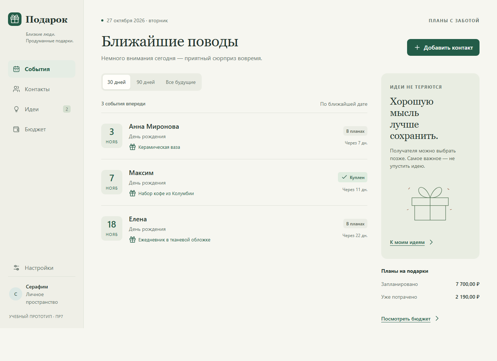

# Подарок

Интерактивный прототип приложения для планирования подарков. Контакты, памятные даты, идеи и расходы собраны в одном месте.

**Практическая работа № 7 · UI/UX и прототип MVP**  
Мирошниченко Серафим · группа 4ИСП-07

[Запуск](#запуск) · [Материалы работы](#материалы-работы) · [Проверки](#проверки)

## Запуск

1. [Скачайте проект в ZIP](https://github.com/serovivan572-ui/Miroshnichenko_Podarki/archive/refs/heads/main.zip) и распакуйте его.
2. Откройте `prototype/podarok/dist/index.html` в Chrome или Edge двойным щелчком.
3. Начните с раздела «События» или добавьте контакт.

Установка, сборка и интернет для запуска не нужны. На GitHub HTML-файл открывается как исходный код, поэтому прототип нужно запускать из скачанной папки.

Демо-аккаунт открыт сразу: в нём четыре контакта и примеры подарков. Для регистрации выберите **Настройки → Выйти из аккаунта → Создать**. Вернуться к примерам можно кнопкой **«Открыть демо»** на экране входа.

## Материалы работы

| Что открыть | Содержание |
| --- | --- |
| [Отчёт Word](docs/ui-ux/Мирошниченко_Серафим_ПР7_UI_UX_Подарок.docx) | Основной отчёт на 18 страницах |
| [Пользовательские сценарии](docs/ui-ux/user-scenarios.md) | Пять сценариев с шагами и ожидаемыми результатами |
| [Навигация](docs/ui-ux/navigation.md) | Экраны и переходы между ними |
| [Макеты экранов](docs/ui-ux/wireframes/) | Восемь wireframe в SVG и PNG; локальная галерея — `index.html` |
| [Визуальная система](docs/ui-ux/design-system.md) | Цвета, шрифты, сетка и состояния элементов |
| [Матрица требований](docs/ui-ux/traceability-matrix.md) | Связь требований, экранов, сценариев и тестов |
| [Результаты проверки](docs/ui-ux/test-results.md) | Протокол прохождения сценариев и исправления |
| [Границы прототипа](docs/ui-ux/simulated-functions.md) | Что работает в интерфейсе и что требует серверной реализации |

Все материалы находятся в [docs/ui-ux](docs/ui-ux/), код приложения — в [prototype/podarok/dist](prototype/podarok/dist/).

## Что можно проверить

- Добавить контакт, интересы и ежегодную памятную дату.
- Создать план подарка, указать бюджет и фактический расход, поменять статус.
- Сохранить идею без получателя и позже назначить её контакту.
- Найти контакт, посмотреть ближайшие события и общий бюджет.
- Изменить или удалить запись с подтверждением.

Данные сохраняются в браузере после обновления страницы. События рассчитаны относительно **27 октября 2026 года**, чтобы примеры оставались одинаковыми при повторной проверке.

Это учебный прототип: данные хранятся в `localStorage`, вход и восстановление пароля имитируются. Сервер и база данных не подключены. Порядок сброса демо-данных описан в [инструкции](docs/ui-ux/prototype-description.md).

## Проверки

В исходном протоколе пройдено **12 из 12 UI-проверок**. Скриншоты находятся в [evidence](docs/ui-ux/evidence/), подробные результаты — в [test-results.md](docs/ui-ux/test-results.md) и [test-results.json](docs/ui-ux/test-results.json).

Повторный запуск через Playwright описан в [инструкции по проверкам](docs/ui-ux/checks.md). Для просмотра приложения эти инструменты не нужны.
