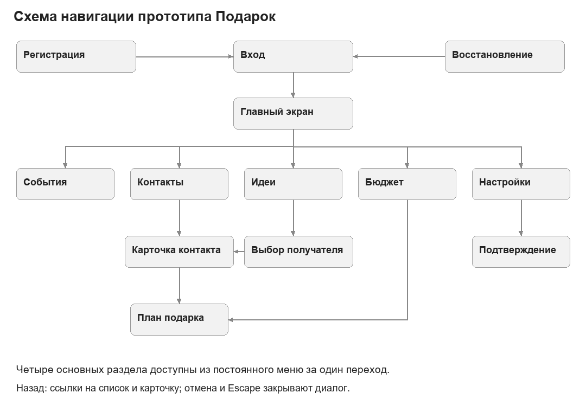
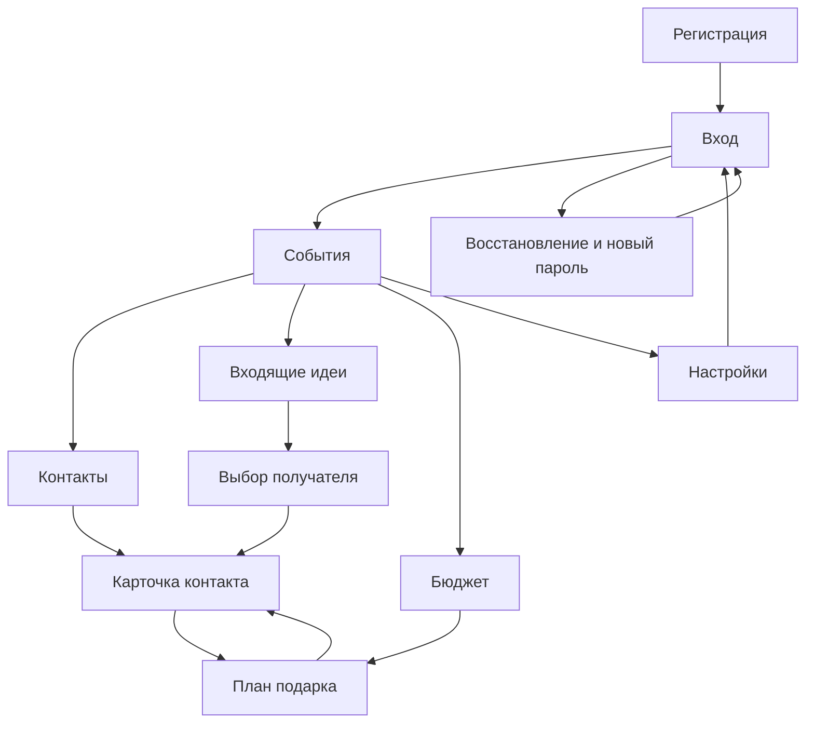

# Навигация

События, контакты, идеи и бюджет доступны из постоянного бокового меню на ПК и нижней панели на узком экране. Профиль ведёт в настройки. Из карточки можно открыть план; из бюджета — тот же план. Контекст возвращается ссылкой на контакт.

Схема отражает маршруты прототипа; это не сеть отдельных backend-сервисов.

